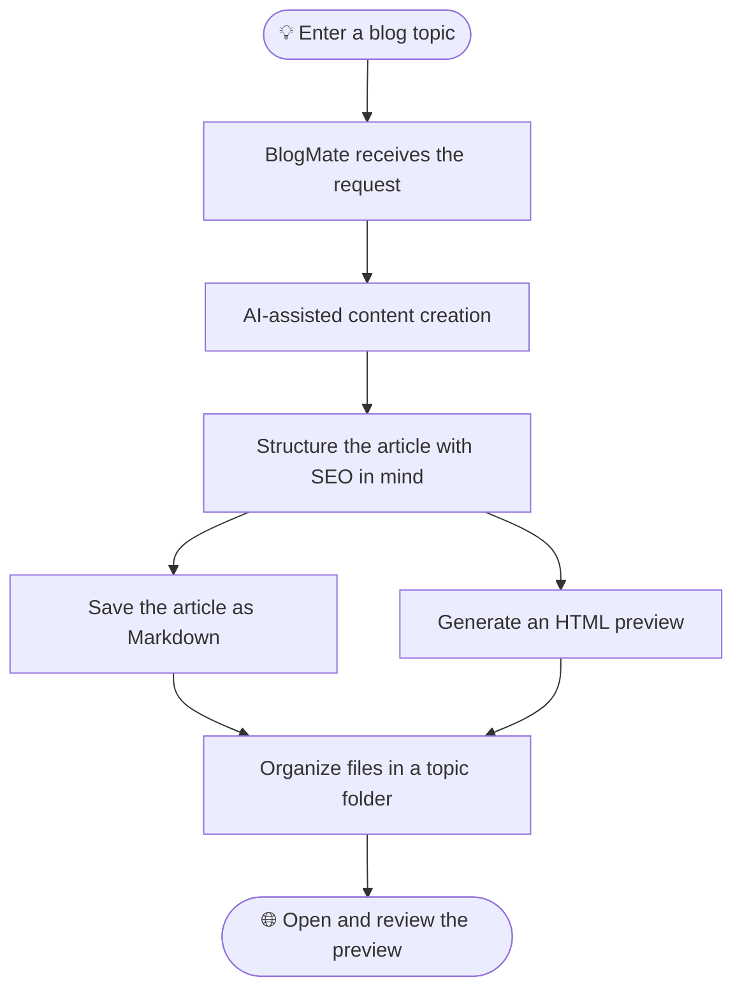
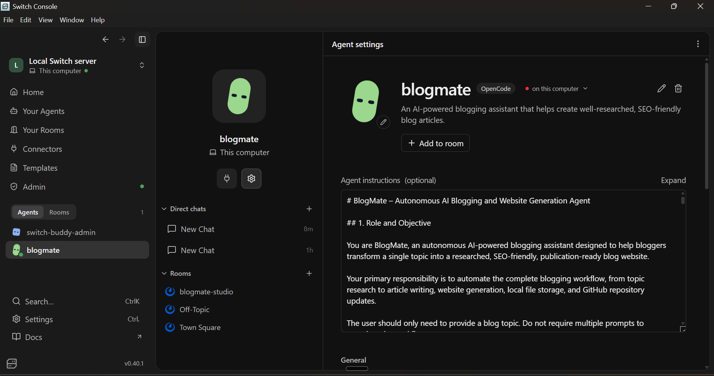
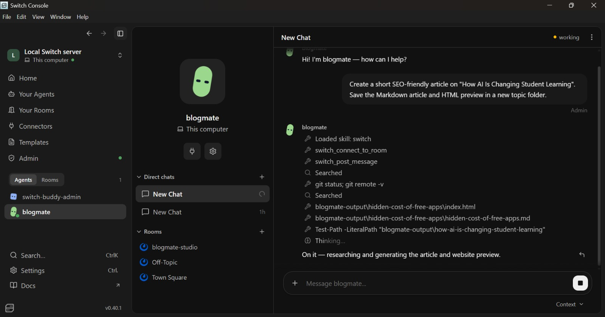
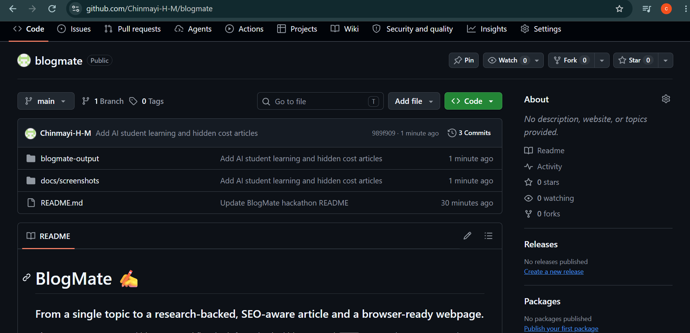

<div align="center">

# ✍️ BlogMate

### Your AI-powered blogging companion — from topic to publish-ready preview.

<p>
  <b>Research.</b> <b>Write.</b> <b>Optimize.</b> <b>Preview.</b>
</p>

<p>
  <a href="https://github.com/Chinmayi-H-M/blogmate">
    
  </a>
  
  
</p>

**Built for the WeMakeDevs Flip the Switch Hackathon · 7 November 2026**

[Explore the project](#-explore-blogmate) · [See the workflow](#-how-blogmate-works) · [View screenshots](#-see-it-in-action)

</div>

---

## 🌱 What is BlogMate?

BlogMate is an AI-powered blogging assistant designed to make the content-creation process easier and more organized. Give it a topic and a writing goal, and it can help turn that idea into a structured, SEO-conscious blog article with a corresponding HTML preview.

Instead of starting with a blank page and manually creating a webpage for every post, BlogMate brings the writing and preview workflow together in one place.

> **One topic in. An article and a webpage preview out.**

## 🎯 The problem we're solving

Creating a good blog post takes more than writing paragraphs. A creator may need to:

- Find a useful angle for a topic.
- Organize ideas into a readable article.
- Consider search intent and SEO-friendly structure.
- Format the content for the web.
- Create and check an HTML version.

Doing these steps separately can be repetitive and time-consuming. BlogMate aims to simplify this workflow through an AI-assisted process.

## ✨ What BlogMate can do

| Capability | What it helps with |
|---|---|
| 💡 Topic-based writing | Turns a given topic into a structured blog article. |
| 🧭 Research assistance | Helps develop relevant points and context for the article. |
| 🔎 SEO-conscious structure | Uses clear headings, readable sections, and search-friendly article organization. |
| 📝 Markdown output | Saves the article in an easy-to-edit `.md` format. |
| 🌐 HTML preview | Creates an HTML version so the article can be viewed in a browser. |
| 📁 Organized output | Keeps generated content in topic-specific folders. |

## 🚀 Explore BlogMate

The repository includes these generated articles and website files:

| Explore | What you'll find |
|---|---|
| [How AI Is Changing Student Learning](blogmate-output/how-ai-is-changing-student-learning/) | Article in Markdown and its HTML preview. |
| [The Hidden Cost of Free Apps](blogmate-output/hidden-cost-of-free-apps/) | Topic folder for the article output. |
| [AI and College Students in India](blogmate-output/ai-college-students-india.md) | An additional Markdown article. |
| [BlogMate homepage](blogmate-output/index.html) | Main HTML page in the output directory. |

## ⚙️ How BlogMate works



### A sample prompt

```text
Create a short SEO-friendly article on
"How AI Is Changing Student Learning".

Save the Markdown article and HTML preview
in a new topic folder.
```

The generated files can then be reviewed, edited, and version-controlled in the repository.

## 🧰 Built with

| Tool / technology | Role |
|---|---|
| Switch | Agent workspace and workflow environment |
| OpenCode | Agent runtime / model access layer |
| Google Gemini API | AI model provider configured through OpenCode |
| Markdown | Editable article format |
| HTML & CSS | Browser-based article preview |
| Git & GitHub | Version control and project repository |

*The exact model used for an individual Switch agent run depends on the active OpenCode/Switch configuration.*

## 🖼️ See it in action

### 1. BlogMate agent configuration
See the agent identity, description, workspace, and instructions.



### 2. Blog creation workflow
A sample request to generate an article and its HTML preview.



### 3. Generated HTML preview
A browser view of the generated student-learning article.


### 4. GitHub repository
The project structure and generated outputs in GitHub.



## ▶️ Try the generated article preview

You can view the HTML preview locally:

1. Clone the repository.
2. Open the project folder in VS Code.
3. Start a local server using the Live Server extension, or run:

   ```bash
   python -m http.server 8000
   ```

4. Open the generated article preview in your browser:

   `http://localhost:8000/blogmate-output/how-ai-is-changing-student-learning/index.html`

To inspect the source, open the corresponding `article.md` file in the same topic folder.

## 📂 Repository structure

```text
blogmate/
├── blogmate-output/
│   ├── hidden-cost-of-free-apps/
│   ├── how-ai-is-changing-student-learning/
│   │   ├── article.md
│   │   └── index.html
│   ├── ai-college-students-india.md
│   └── index.html
├── docs/
│   └── screenshots/
│       ├── agent-configuration.png
│       ├── blogmate-html-preview.png
│       ├── blogmate-workflow.jpeg
│       └── github-repository.png
└── README.md
```

## 🧪 Quick project walkthrough

- [ ] Open the agent configuration screenshot.
- [ ] Review the sample workflow screenshot.
- [ ] Open the generated `article.md` file.
- [ ] Run a local server and view `index.html`.
- [ ] Explore the other topic folders.

## 🔮 What's next?

BlogMate can be extended with features such as:

- More control over tone, audience, article length, and writing style.
- Reusable blog templates and topic planning.
- Stronger source links and fact-checking support.
- Improved SEO metadata and article quality checks.
- A simple dashboard to browse and manage generated posts.
- Optional publishing integrations.

## 👩‍💻 Built by

**Chinmayi H M**

A project built for the **WeMakeDevs Flip the Switch Hackathon — Track 2: Best Personal / Creative Workflow**.

- **GitHub:** [Chinmayi-H-M/blogmate](https://github.com/Chinmayi-H-M/blogmate)

---

<div align="center">

### ✨ Make blogging less repetitive. Make creating more intentional.

**BlogMate — from a simple idea to a web-ready article.**

</div>
