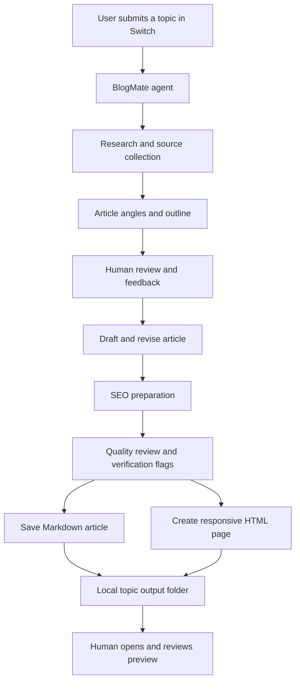

# BlogMate ✍️

### From a single topic to a research-backed, SEO-aware article and a browser-ready webpage.

**BlogMate** is an AI-assisted blogging workflow built for individual bloggers. It brings topic exploration, research, outlining, drafting, SEO preparation, revision, and HTML output into a human-guided workflow using **Switch** and an AI agent.

> Built for the **Flip the Switch Hackathon 2026** · Track 2: Best Personal / Creative Workflow


---

## Table of contents

- [The problem](#the-problem)
- [What BlogMate does](#what-blogmate-does)
- [How it uses Switch](#how-it-uses-switch)
- [Workflow](#workflow)
- [Technology](#technology)
- [Repository structure](#repository-structure)
- [Try the generated article](#try-the-generated-article)
- [Screenshots](#screenshots)
- [Setup and usage](#setup-and-usage)
- [Current scope and limitations](#current-scope-and-limitations)
- [Future improvements](#future-improvements)

## The problem

Independent bloggers often repeat the same time-consuming steps for every post:

1. Find a useful topic and a distinctive angle.
2. Research facts and keep track of reliable sources.
3. Organise the article into a readable structure.
4. Draft, revise, and check the content.
5. Prepare SEO metadata.
6. Turn the finished draft into a webpage.

AI writing tools can speed up drafting, but a fast draft is not necessarily a trustworthy or publishable article. BlogMate aims to make the entire preparation workflow easier while keeping the writer involved in important decisions and final review.

## What BlogMate does

BlogMate is designed to help a blogger move from a topic to publication-ready materials:

- **Topic exploration:** suggest useful angles and clarify the intended audience.
- **Research:** find relevant sources and retain links for fact-checking.
- **Outlining:** organise the article before drafting.
- **Writing and revision:** create a draft and incorporate the writer's feedback.
- **SEO preparation:** prepare a title, description, keywords, and URL slug.
- **Quality review:** flag claims or details that need human verification.
- **Two output formats:** save the article as Markdown and create a responsive HTML page for browser preview.

The writer remains responsible for reviewing the article and deciding whether and where to publish it. BlogMate does not autonomously publish content to a CMS.

## How it uses Switch

Switch is the collaboration layer through which the user communicates with the BlogMate agent in a room.

In this project:

1. The user sends a topic or instruction in the BlogMate room.
2. The BlogMate agent receives the request and responds in that room.
3. The user can review suggestions, give feedback, and request revisions.
4. The agent works in its local workspace and saves the resulting files.
5. The agent reports the output paths so the user can open and review them.

The agent is run through **OpenCode**. A Google Gemini API key has been authenticated in OpenCode, and the `google/gemini-3.8-flash` model was successfully tested from the OpenCode CLI. The exact model used by a Switch agent session should be confirmed in the running Switch workflow before describing it as verified end-to-end.

Switch provides the room-based interaction and agent coordination. It does not host the generated webpage or provide a publishing service in this prototype.

## Workflow



The workflow is human-guided: the writer can approve the direction, provide corrections, and review the final files before publication.

## Technology

| Technology / tool | Role |
|---|---|
| Switch | Room-based interaction and agent collaboration |
| OpenCode | Agent execution environment |
| Google Gemini API | Model provider authenticated in OpenCode |
| Gemini 3.8 Flash | Model successfully tested through the OpenCode CLI; Switch session usage requires end-to-end confirmation |
| Markdown | Editable article source |
| HTML5 | Webpage structure |
| CSS3 | Responsive layout and presentation |
| Vanilla JavaScript | Lightweight page interactions, where included |
| Git and GitHub | Version control and public project repository |

## Repository structure

The repository contains the README and generated blog content. The exact contents may grow as more topics are processed.

```text
blogmate/
├── README.md
└── blogmate-output/
    ├── ... topic-specific article files ...
    └── ... HTML preview files ...
```

A generated topic folder may contain a Markdown article and an HTML preview. Check the repository for the latest actual filenames; this diagram intentionally avoids claiming files that may not yet have been committed.

## Try the generated article

The generated HTML file is a static webpage. To preview it locally:

1. Open the relevant topic folder.
2. Double-click its `index.html` file, or open it in a browser.
3. Review the article, navigation, and responsive layout.

You can also start a local server from the repository folder:

```powershell
python -m http.server 8000
```

Then visit `http://localhost:8000` and navigate to the relevant HTML file.

The local preview is available on the computer running the server; it is not a public deployment.

## Screenshots

Add real screenshots here before final submission. Do not leave placeholders in the final README.

Create this folder:

```text
docs/
└── screenshots/
    ├── switch-room.png
    ├── agent-configuration.png
    ├── markdown-output.png
    └── html-preview.png
```

Then uncomment or add the corresponding image references:

```markdown
### Switch room interaction


### Agent configuration


### Generated Markdown article


### HTML preview

```

Capture the actual application and output. Redact API keys, tokens, private paths, and personal information before committing screenshots.

## Setup and usage

### Requirements

- Switch installed and running.
- OpenCode installed and configured as the agent execution provider.
- A supported model provider authenticated in OpenCode.
- A browser to preview the generated HTML.
- Git for version control (optional for running the local preview).

### Use BlogMate

1. Open Switch.
2. Open the BlogMate room.
3. Send a blog topic and any audience or tone guidance.
4. Review the agent's research, outline, and draft.
5. Give feedback or request revisions.
6. Open the generated Markdown and HTML files from the paths reported by the agent.
7. Review and fact-check the content before publishing.

### View the HTML output

Open the generated `index.html` in a browser. No frontend framework or package installation is required for a self-contained HTML output.

## Current scope and limitations

This repository documents a working prototype and its generated content, not a hosted blogging platform.

- The workflow uses a human-in-the-loop agent interaction.
- The outputs are Markdown and HTML files in a local workspace.
- There is no backend, database, CMS integration, or automated publishing pipeline in this prototype.
- A local HTML preview is not the same as public website hosting.
- Research links and factual claims still require human review.
- Gemini was verified through the OpenCode CLI; verify the model selection in Switch before claiming that the Switch session uses that exact model.

## Future improvements

- Automatically generate a consistent HTML page from a reusable template.
- Create an index page for multiple articles.
- Add automated checks for broken links, missing headings, duplicate IDs, and SEO metadata.
- Add a review checklist for claims that need verification.
- Add optional publishing integrations after human approval.
- Add multilingual article generation and accessibility checks.
- Add a repeatable GitHub commit-and-push workflow with explicit user approval.

## Project links

- **GitHub repository:** https://github.com/Chinmayi-H-M/blogmate
- **Hackathon:** https://www.wemakedevs.org/hackathons/switch
- **Demo video:** Add the final demo URL here.

---

*BlogMate is a prototype built to explore how room-based agent collaboration can support a real creative workflow. The goal is not to replace the blogger, but to reduce repetitive work and leave more time for ideas, judgement, and storytelling.*
